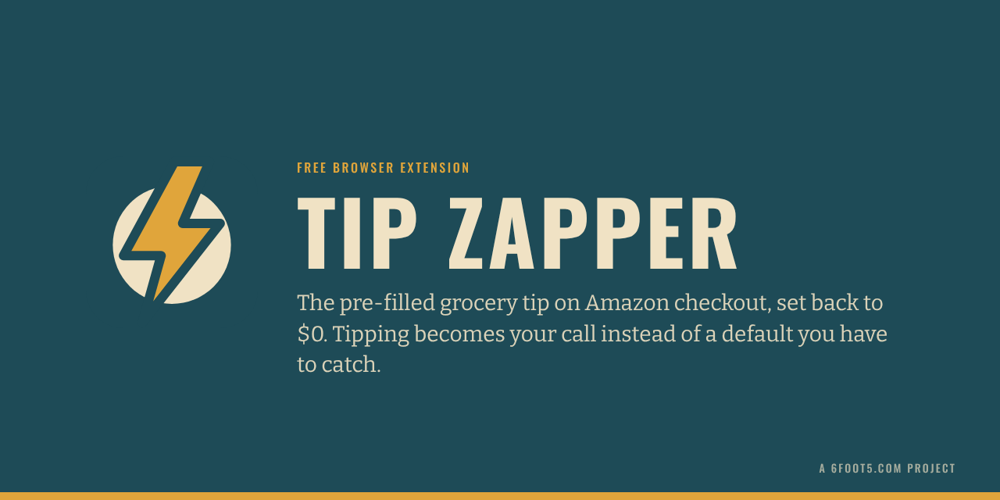
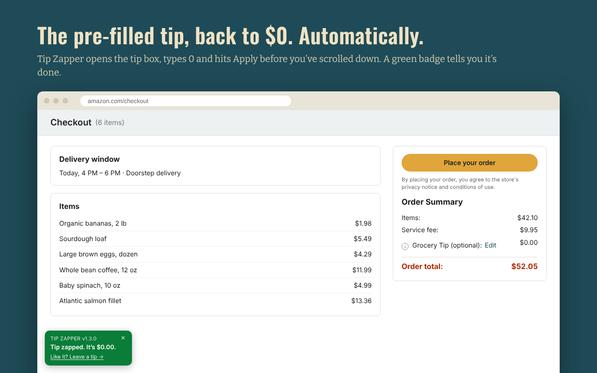
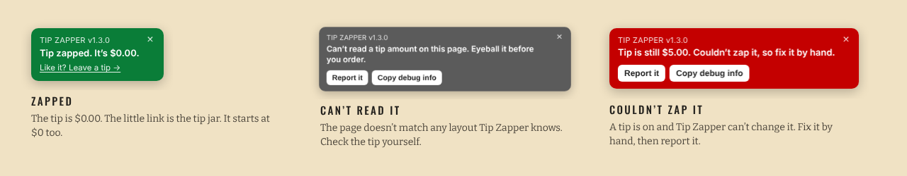
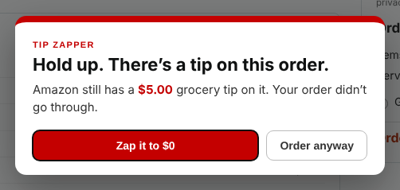

<p align="center">
  
</p>

# Tip Zapper

When you check out a Whole Foods or Amazon Fresh order on amazon.com, Amazon fills in a grocery tip for you. Tip Zapper is a small, free browser extension that sets it back to $0, so a tip is something you choose instead of something you have to remember to undo.

It does two things:

1. **Zaps the tip.** On the checkout page it opens the tip box, types 0 and presses Apply. A badge in the bottom-left corner tells you it's done.
2. **Guards the button.** If you click **Place your order** while a tip above $0 is still showing, it holds the click and asks first.

It never clicks Place your order itself. That click stays yours.

<p align="center">
  
</p>

## Install

| Browser | How |
|---|---|
| Chrome, Brave, Edge | Chrome Web Store: *listing coming soon* |
| Firefox | Firefox Add-ons: *listing coming soon* |
| Any of them, today | Download the zip from [Releases](https://github.com/adamarussell-sudo/tip-zapper/releases) and load it by hand ([steps](docs/USER_GUIDE.md#install-by-hand)) |

The full walkthrough, including what each badge means and what to do when something looks off, is in the **[User Guide](docs/USER_GUIDE.md)**.

## What you'll see

<p align="center">
  
</p>

And if a tip is still on when you click Place your order:

<p align="center">
  
</p>

**Zap it to $0** fixes the tip. **Order anyway** turns the guard off for that page.

## Privacy

Tip Zapper collects nothing. No account, no analytics, no network requests, no storage. It only runs on `www.amazon.com` and only does anything on checkout pages. The one thing it can put on your clipboard is the debug info, and only when you click the button. Details are in [PRIVACY.md](PRIVACY.md).

## When it breaks

Amazon changes its checkout page now and then, and when it does, Tip Zapper may stop finding the tip. You'll know because the badge turns gray or red instead of green.

Click **Report it** on the badge. It copies a scrubbed snapshot of the tip section to your clipboard and opens a bug report here. Paste it in, and the fix is usually quick. Hidden form fields and long tokens are stripped out, and it only grabs the tip section, so your address and payment details stay out of it. Give it a glance before you paste anyway.

## Support the project

Tip Zapper is free, and it'll stay free. If it saves you some clicks and you'd like to say thanks, there's a tip jar at **[6foot5.com/tip-zapper](https://6foot5.com/tip-zapper/)**.

Yes, a tip jar on the Tip Zapper. The difference is this one starts at $0 and stays there unless you change it.

## Development

```bash
npm install
npm test          # runs content.js against 14 mock checkout pages in jsdom (about 10 seconds)
npm run build     # writes dist/tip-zapper-<version>-chrome.zip and -firefox.zip
npm run brand     # re-renders icons and store images (needs Playwright, see the script header)
```

More docs: [User Guide](docs/USER_GUIDE.md) · [Brand](docs/BRAND.md) · [Launch checklist](docs/LAUNCH_CHECKLIST.md) · [Store listings](store/) · [Changelog](CHANGELOG.md)

The whole extension is one content script, [`extension/content.js`](extension/content.js), with no build step and no dependencies. [`tests/fixtures.js`](tests/fixtures.js) holds the real Amazon tip widget markup the tests run against. See [CONTRIBUTING.md](CONTRIBUTING.md) before sending a change, especially the ground rules.

## Not affiliated with Amazon

Tip Zapper is an independent open-source project. It isn't affiliated with, endorsed by or sponsored by Amazon. Amazon, Whole Foods Market and Amazon Fresh are trademarks of their owners and are named here only to say what the extension works with.

## License

[MIT](LICENSE) © 2026 Adam Russell · Built in Dayton, Ohio, with help from Claude.
