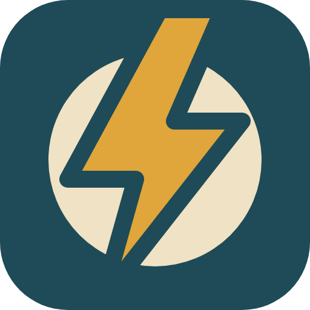
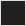
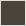

# Tip Zapper Brand

Tip Zapper borrows its colors and type from [6foot5.com](https://6foot5.com), the site it lives on: cream paper, dark ink, a lake-blue field and a mustard accent. The look is a craftsman's label more than an app-store gadget. It's plain, warm and a little retro.

## The mark

A bolt striking a coin: the tip, zapped. The bolt carries a Lake-colored cut line where it crosses the coin, so the two shapes stay separate at small sizes.

| File | Use |
|---|---|
| [`brand/icon.svg`](../brand/icon.svg) | The master mark. Used at 32px and up. |
| [`brand/icon-small.svg`](../brand/icon-small.svg) | Bolt only. Used at 16px, where the coin turns to mush. |
| `extension/icons/icon{16,32,48,128}.png` | Rendered from the SVGs by `npm run brand`. The 128 has 16px of transparent padding, per Chrome Web Store guidelines. |

Don't recolor the mark, add outlines or effects, or set it on a busy photo. On dark backgrounds use it as is. On cream or white it already has its own Lake tile.

## Colors

| Swatch | Name | Hex | Used for |
|---|---|---|---|
|  | Lake | `#1E4B57` | Icon tile, banners, store backgrounds |
|  | Mustard | `#E0A53B` | The bolt, kickers, accent rules |
|  | Cream | `#F0E2C4` | The coin, the wordmark, light panels |
|  | Ink | `#22201C` | Text on cream |
|  | Muted | `#4A443A` | Secondary text on cream |
|  | Rust | `#A8481F` | Hover and highlight, sparingly |

**Status colors** live only in the extension's badge and popup. They're picked for readability on any page, not for the brand.

| State | Hex |
|---|---|
| Zapped (green) | `#0A7D38` |
| Working (amber) | `#9A5B00` |
| Can't read (gray) | `#5B5B5B` |
| Couldn't zap / blocked (red) | `#C40000` |

No pinks or pastels, ever.

## Type

- **Oswald**: the wordmark (700, all caps, slight tracking), headlines (600) and small kicker labels (500, all caps, wide tracking).
- **Bitter**: body copy and taglines (400).
- **System sans**: inside the extension's badge and popup, so they match whatever page they sit on.

Both web fonts are free under the SIL Open Font License and come in through `@fontsource` for rendering.

## Name and voice

- It's **Tip Zapper**: two words, both capitalized. In the wordmark it's all caps: TIP ZAPPER.
- Plain, dry and helpful. Say what it does in short sentences. A small joke is fine if it rides on something true ("This one starts at $0 too").
- Neutral on tipping. Tip Zapper removes a default. It doesn't tell anyone whether or how much to tip.
- Never imply a connection to Amazon. Don't use Amazon's logo, smile arrow, colors or fonts. Name Amazon only to say what the extension works with.

## Assets

| Image | Size | File |
|---|---|---|
| README banner / GitHub social preview | 1280×640 | `docs/images/banner.png` |
| Store screenshots | 1280×800 | `store/images/screenshot-{1-zapped,2-guard,3-quiet}.png` |
| Chrome small promo tile | 440×280 | `store/images/promo-small-440x280.png` |
| Chrome marquee promo tile | 1400×560 | `store/images/promo-marquee-1400x560.png` |
| Store icon | 128×128 | `store/images/icon-128.png` |

All of these are generated by [`scripts/render-brand.js`](../scripts/render-brand.js). The screenshots run the real `content.js` on a generic mock checkout page, so the badge and popup in them are the actual UI.
