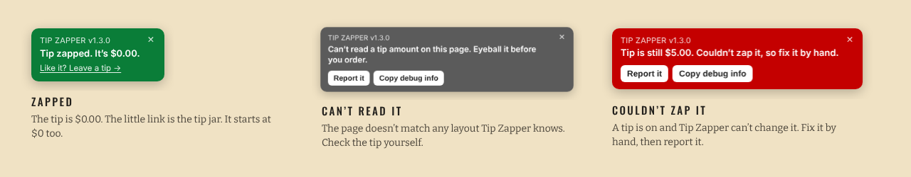
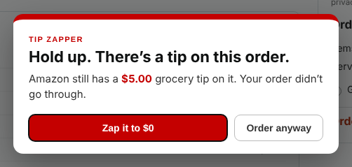

# Tip Zapper User Guide

Tip Zapper sets the pre-filled grocery tip on Amazon checkout back to $0 and stops you before you place an order with a tip still on. This guide covers installing it, what you'll see at checkout, and what to do when something looks off.

- [Install](#install)
- [Your first checkout](#your-first-checkout)
- [The badge](#the-badge)
- [The popup](#the-popup)
- [Updating](#updating)
- [Turning it off](#turning-it-off)
- [Troubleshooting](#troubleshooting)
- [FAQ](#faq)

## Install

### From a store

| Browser | Store | Notes |
|---|---|---|
| Chrome | Chrome Web Store | *Listing coming soon* |
| Brave | Chrome Web Store | Brave installs Chrome Web Store extensions directly |
| Edge | Edge Add-ons or Chrome Web Store | For the Chrome store, Edge asks you to allow extensions from other stores the first time |
| Firefox | Firefox Add-ons | *Listing coming soon* (needs Firefox 140 or newer) |

### Install by hand

Use this until the store listings are live, or if you'd rather run the code straight from GitHub.

**Chrome, Brave or Edge**

1. Download `tip-zapper-<version>-chrome.zip` from the [Releases page](https://github.com/adamarussell-sudo/tip-zapper/releases).
2. Unzip it into a folder that can stay put, like `Documents/tip-zapper`. The browser runs it from that folder, so don't delete or move it.
3. Open the extensions page: `chrome://extensions` in Chrome, `brave://extensions` in Brave, `edge://extensions` in Edge.
4. Turn on **Developer mode**. It's a switch in the top-right corner (in Edge, on the left side).
5. Click **Load unpacked** and pick the folder that has `manifest.json` directly inside it.

The Tip Zapper card shows up with its version number. That's it.

**Firefox**

Firefox only keeps unsigned extensions until you restart it, so for everyday use wait for the Firefox Add-ons listing. To try it out now:

1. Download `tip-zapper-<version>-firefox.zip` from Releases.
2. Open `about:debugging#/runtime/this-firefox`.
3. Click **Load Temporary Add-on** and pick the zip.

## Your first checkout

Add Whole Foods or Amazon Fresh groceries to your cart and go to checkout like normal. Within a second or two of the page loading, Tip Zapper:

1. Finds the line that says **Grocery Tip (optional)**.
2. Clicks **Edit**, types **0** into the tip box and clicks **Apply**.
3. Shows a green badge in the bottom-left corner: *Tip zapped. It's $0.00.*

Check the order summary once. The tip line should read $0.00 and the total should have dropped to match. After that, place your order the way you always do.

If Amazon puts a tip back on, say after you change your delivery window, Tip Zapper zaps it again.

## The badge

The badge sits in the bottom-left corner on checkout pages and nowhere else. The version number at the top tells you which version is running.

| Badge | Meaning | What to do |
|---|---|---|
| **Green**: Tip zapped. It's $0.00. | Tip Zapper changed the tip to $0. | Nothing. The small *Like it? Leave a tip* link is the developer's tip jar. It's optional and starts at $0. |
| **Green**: Tip is $0.00. Nothing to zap. | The tip was already $0. | Nothing. |
| **Amber**: Zapping the tip… | It's mid-change, or waiting for Amazon to update the total. | Give it a second. |
| **Gray**: Can't read a tip amount on this page. | The page doesn't match any layout Tip Zapper knows. | Check the tip yourself, then click **Report it**. |
| **Red**: Tip is still $X. Couldn't zap it. | A tip is on and Tip Zapper couldn't change it. | Fix the tip by hand, then click **Report it**. |

Click **×** to hide the badge on that page.

## The popup

If you click **Place your order** while a tip above $0 is still on the order, Tip Zapper stops the click, so your order doesn't go through, and shows this:

- **Zap it to $0** sets the tip to zero. Then click Place your order again.
- **Order anyway** turns the guard off for that page. Click Place your order again and it goes through with the tip.
- **Esc** or clicking outside the box just closes it.

The guard watches two places: the tip line in the order summary, and the tip box itself if you've opened it. So if you type an amount but never click Apply, it still catches it.

## Updating

Store installs update on their own.

For a hand install, replace the files in your tip-zapper folder with the new version's files, open the extensions page and click the reload arrow on the Tip Zapper card. Then **refresh the checkout page** or restart the browser. A checkout tab that was already open keeps running the old version until it reloads. Check the version number on the badge to confirm.

## Turning it off

- **For one order:** click **Order anyway** in the popup, or tip after delivery (see the FAQ).
- **For a while:** switch Tip Zapper off on the extensions page.
- **For good:** click **Remove** on the extensions page.

## Troubleshooting

**No badge at all on the checkout page**
- Make sure the extension is switched on and the URL starts with `https://www.amazon.com/`. It doesn't run on amazon.ca, amazon.co.uk or other Amazon sites yet.
- In Firefox, open the Extensions menu (the puzzle piece) and make sure Tip Zapper is allowed on amazon.com.
- If you just installed or updated it, refresh the checkout page.

**The badge shows an old version number after an update**
Restart the browser. An open tab can keep the old script running until it fully reloads.

**Gray or red badge**
Fix the tip by hand for this order, then click **Report it** on the badge. It copies the debug info and opens a bug report on GitHub. Paste the debug info into the report and add anything that seemed odd. You'll need a free GitHub account to file it.

**What's in the debug info?** The page path (no query string), what Tip Zapper read and did, and a scrubbed copy of the tip section's HTML. Scripts, images, hidden form fields and long attribute values are stripped. It only grabs the tip section, so your address and payment details shouldn't be in it. Give it a quick look before you paste it anyway.

## FAQ

**Can I still tip?**
Yes. Amazon lets you add or change a tip for up to 24 hours after delivery (the checkout page says so in the tip section). You can also click **Order anyway** at checkout, or tip in cash. Tip Zapper only takes away the default.

**Does it work on regular, non-grocery Amazon orders?**
Regular orders don't carry a tip, so there's nothing for it to do. It stays quiet.

**Does it collect or send any data?**
No. See [PRIVACY.md](../PRIVACY.md).

**Why does it need access to amazon.com?**
To see the tip on the checkout page, change it, and show the badge. It does nothing anywhere else.

**Will it ever place an order for me?**
No. Tip Zapper is built so it can't click Place your order. The code refuses to click any button labeled place your order, buy now, pay now, submit order, proceed, continue or check out.

**Is this made by Amazon?**
No. It's an independent open-source project and isn't affiliated with Amazon.
